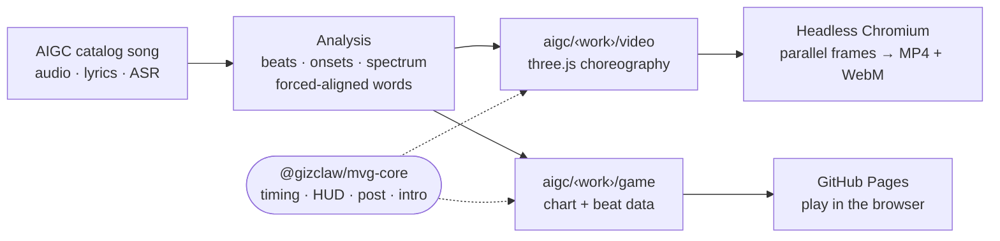

<div align="center">


# Music Video Games

**Beat-synced music videos and rhythm games for haivivi's STEM songs, written entirely in code.**<br />
Every frame is a function of the song's time. No generative video model, no keyframes, no stock footage.

[](https://gizclaw.github.io/music-video-games/)

[](https://github.com/GizClaw/music-video-games/actions/workflows/ci.yml)
[](https://github.com/GizClaw/music-video-games/actions/workflows/pages.yml)
[](https://threejs.org/)
[](https://vite.dev/)
[](LICENSE)

</div>

## Play

<table>
  <tr>
    <td width="290"><a href="https://gizclaw.github.io/music-video-games/#/stem-institute/spectrum-slide/play"></a></td>
    <td>
      <h3>Slide Down the Spectrum</h3>
      <p>Ride a photon down the light tunnel from the music video. The song's own beats and drum hits build the chart.</p>
      <ul>
        <li>Steer round the tunnel wall with <kbd>←</kbd> <kbd>→</kbd>, <kbd>A</kbd> <kbd>D</kbd>, a mouse or a finger</li>
        <li>Catch a photon on every beat, with half-beat runs in the choruses</li>
        <li>Thread the gap in the red <b>γ gates</b>, or lose your combo</li>
        <li>The tunnel turns from radio to gamma as the lyrics name each band</li>
        <li>Multiplier up to ×4, karaoke lyrics and an S–D grade at the end</li>
        <li>Works on phones and desktops, with no install and no sign-in</li>
      </ul>
      <p><a href="https://gizclaw.github.io/music-video-games/#/stem-institute/spectrum-slide/play"><b>Play it →</b></a></p>
    </td>
  </tr>
</table>

## Matter Run

**One little drop, four superpowers.** A 3D runner for *States of Matter*: change into ice, water, vapor or plasma with **A S D F** or the left touch controls, then press **Space** or the right action button to smash, slide, jump or zap through the laboratory obstacles on the beat. Combos build speed and score bonuses; misses slow the runner, and reaching the minimum speed ends the run. The English song and highlighted lyrics keep their original tempo. Finish the song for a score and grade.

Run locally with `npm run dev`, then `npm run play -- states-of-matter`. The game is also selectable from the States of Matter planet in the STEM galaxy. See the [game guide](packages/games/README.md#matter-run--states-of-matter) for scoring, audio sync and embedding.

## Angle Gang

**Set the angle. Let it fly.** Hold and turn the wheel to select an angle in *The Angle Gang*. While held, the aircraft approaches the chosen heading. Releasing the wheel returns its rim and centre readout to zero and commands the aircraft back to 0°. **A / D** and **← / →** adjust by 15°; continuous wheel rotation selects complete circles. Thirty musical checkpoints, a simple steering wheel with 0° on the right, the wheel angle in its hub and a labelled target mark on its rim accompany the original song and large sing-along lyrics.

Run `npm run dev`, then `npm run play -- angle-gang`, or choose The Angle Gang in the STEM galaxy. See the [game guide](packages/games/README.md#angle-gang--sky-turn) for controls, scoring and embedding.

## The videos

All twenty-five songs from the STEM Institute album, each 1080×1920 at 30 fps and cut to
the detected beat, with forced-aligned karaoke lyrics. Optional catalog
translation tracks add small, static Chinese subtitles beneath the animation,
burned into the picture by default or delivered as companion SRT files.

<table>
  <tr>
    <td align="center"><br /><sub><b>No. 3</b><br />Molecule Shapes</sub></td>
    <td align="center"><br /><sub><b>No. 4</b><br />States of Matter</sub></td>
    <td align="center"><br /><sub><b>No. 5</b><br />Pi Keeps Going</sub></td>
    <td align="center"><br /><sub><b>No. 6</b><br />Polygon Party</sub></td>
    <td align="center"><br /><sub><b>No. 8</b><br />Prime Time</sub></td>
    <td align="center"><br /><sub><b>No. 12</b><br />Newton's Three</sub></td>
  </tr>
  <tr>
    <td align="center"><br /><sub><b>No. 14</b><br />Prefix Power</sub></td>
    <td align="center"><br /><sub><b>No. 15</b><br />Slide Down the Spectrum</sub></td>
    <td align="center"><br /><sub><b>No. 17</b><br />Energy Shapeshifter</sub></td>
    <td align="center"><br /><sub><b>No. 22</b><br />Planet Parade</sub></td>
    <td align="center"><br /><sub><b>No. 23</b><br />Binary Boogie</sub></td>
    <td></td>
  </tr>
</table>

## How it works



- **Beat-locked.** AI-generated songs drift in tempo, so scenes follow the detected beat list rather than a fixed grid. Kicks, snares and a 32-band spectrum drive the motion.
- **Words on the syllable.** Lyrics are force-aligned to a Demucs vocal stem, so a digit flips or a planet lands on the sung word.
- **Deterministic.** Frames are pure functions of time with seeded randomness, so four browser workers render segments in parallel and the segments join without re-encoding.
- **One scene, two outputs.** A game reuses its video's scenes and colours, then adds input, a chart and a score.

## Layout

```text
music-video-games/
├── packages/
│   ├── core/    @gizclaw/mvg-core   timing, HUD, post-processing, haivivi intro (shared)
│   ├── video/   @gizclaw/mvg-video  mvg-video CLI, renderer page, beat/lyric analysis (Python)
│   └── games/   @gizclaw/mvg-games  complete universe entrance, catalog, scenes, music and games
├── aigc/                            mirrors the AIGC catalog (gizclaw/catalogs/aigc/)
│   └── songs/<category>/<album>/<lang>/<id>/
│       ├── video/                   choreography: song.js and its scenes
│       └── game/                    optional game data: analysis.json (the game is in packages/games)
├── site/                            thin GitHub Pages host: index.html mounts the games SDK
└── scripts/check.mjs                layout and syntax check
```

The repository is one npm workspace; song code imports shared modules by
package name (`@gizclaw/mvg-core/timing.js`, `@gizclaw/mvg-games/kit.js`).

**Catalog matching.** A song's directory is its catalog work path. The work
`songs/music/stem-institute/en-us/spectrum-slide` is choreographed by
`aigc/songs/music/stem-institute/en-us/spectrum-slide/video/song.js`, and its
game lives beside it in `game/`. Passing the same `--work` to the CLI is all it
takes to find the right tool.

## Quick start

```sh
npm ci
npm run dev        # games at http://localhost:5179/
```

<details>
<summary><b>Render a video</b></summary>

<br />

Music, lyrics and media stay with the catalog owner; this repository holds code
only. The CLI reads a song from a mounted GizClaw root and writes back there:

Set `--root <directory>` or `GIZCLAW_ROOT` to your mounted media/cache/build
root. For local defaults, copy `.env.example` to `.env.local` and edit the path;
`.env.local` is ignored by Git. Command-line options override environment
variables, which override `.env.local` in the choreography project (`--project`).

| What | Path under the configured media root |
| --- | --- |
| Song input | `catalogs/aigc/<work>.ogg`, `.srt` |
| Analysis cache | `cache/aigc/<work>/analysis.json` |
| Build intermediates | `build/aigc/<work>/` |
| Deliverables | `catalogs/aigc/<work>.mp4` (original quality), `.webm` (VP9) |

```sh
npx playwright install chromium
npx mvg-video --work spectrum-slide prepare           # analysis for one song
npx mvg-video --work spectrum-slide snap look 12.6 42 # contact sheet under build/
npx mvg-video --work spectrum-slide preview           # live preview with audio
npx mvg-video --work spectrum-slide render            # clearance, frames, MP4 + WebM
```

Each run builds one song. `--work` takes the song id when it is unique, or the
full catalog work path (`songs/music/stem-institute/en-us/spectrum-slide`).
`--subtitles embed` burns static Chinese into the picture (default);
`--subtitles external` writes a companion `.zh-CN.srt` beside the video;
`--subtitles none` omits Chinese from a new render.

For users without a package install, the release's core and video tarballs can
be passed directly to `npx --yes --package=<core-url> --package=<video-url> mvg-video`.
New [GitHub Release notes](https://github.com/GizClaw/music-video-games/releases)
include complete commands; see the [video package guide](packages/video/README.md#run-with-npx)
for prerequisites and command options. npx caches the tool without adding project dependencies.

`--catalog <dir>` points at the AIGC catalog source so the published title lands
in the file metadata. Other commands: `encode`, `inspect`, `clearance` and
`game-data`. Analysis needs `uv` (Python 3.12); lyric refinement downloads its
models into `<root>/cache/models`; encoding needs `ffmpeg`.

</details>

<details>
<summary><b>Build the games site</b></summary>

<br />

```sh
npm run build      # dist/, deployed to GitHub Pages on every push to main
```

The site root mounts the full 3D music universe from `@gizclaw/mvg-games/universe.js`.
The SDK owns its catalog, scenes, styles and music; `site/index.html` is only a host.
Every song album
of the AIGC catalog is a galaxy on a horizontal carousel and every song a
planet; planets with a game are coloured, the rest stay grey until their game
ships. `npm run universe:catalog` rewrites `packages/games/src/universe/universe.json` (albums, songs,
zh/en names) from the mounted catalog (`--catalog <dir>`, `--verify` checks the
audio on the CDN); `packages/games/src/universe/catalog.js` adds planet looks and game entries on top. Picking a planet crossfades to its song, and clicking a playable one
dives into it and mounts the game in place. The hash holds the route
(`#/<series>/<work>/play`). Arrow keys or A/D, Enter and Esc drive everything;
the mouse works throughout.

Games are reached through the universe only; there are no per-game pages, and
hosts can mount the entire entrance with `mountUniverse(target)` (the bundled
catalog and styles are included), or mount a single game from `@gizclaw/mvg-games`
(`mountSpectrumSlide`, `mountPlanetParade`, `mountBinaryBoogie`, `mountPrimeTime`, `mountPenguinSteps`, `mountStatesOfMatter`, `mountPolygonParty`, `mountFrogHopStop`, `mountAngleGang`). A route
straight into a game skips the opening stage, and it can carry game options:
`#/stem-institute/binary-boogie/play?start=31&auto`. From the browser console,
`__universe.play("binary-boogie", { start: 31, auto: true })` jumps there and
`__universe.open("stem-institute")` flies to a galaxy. With the dev server
running, `npm run play -- binary-boogie --start 31 --auto` opens that route
(`--port`, `--base` or `--print` to only show the URL). Games stream the
published catalog audio from `static-volc.gizclaw.com`.

`@gizclaw/mvg-core`, `@gizclaw/mvg-games` and `@gizclaw/mvg-video` are attached to
GitHub Releases as npm tarballs. The manually dispatched `release` workflow
owns packaging; Deploy owns publication to the TOS npm registry.

</details>

## Package docs

- [`@gizclaw/mvg-core`](packages/core/README.md): timing, HUD, opening, post-processing and shared assets.
- [`@gizclaw/mvg-video`](packages/video/README.md): analysis, lyric alignment and placement, song modules, rendering and deliverables.
- [`@gizclaw/mvg-games`](packages/games/README.md): embeddable universe entrance, catalog, game layout and the Slide Down the Spectrum, Planet Parade, Binary Boogie, Prime Time, Penguin Step Party, Matter Run and Polygon Party charts.

## Releases

Run **Actions → release → Run workflow** on `main`. The workflow generates a UTC
tag `vYYYYMMDD-HHMMSS` for the checked-out commit. Each public workspace keeps its
own stable SemVer in `package.json`; the tag is a release snapshot, not an npm
version. Bump only packages whose tarball contents change, and synchronize any
workspace dependencies that pin those packages. A previously published version
can appear in another snapshot only when its tarball is byte-for-byte identical.

Every release contains the three versioned npm tarballs, `npm-index.json` and
`SHA256SUMS`. The format-1 index records the repository, snapshot tag (`version`),
source commit, workflow and each package's name, version, tarball, byte size and
SHA-256. `SHA256SUMS` covers the tarballs and index. Deploy can use these inputs
to verify an import before publishing to TOS; registering this repository and
its package ownership in Deploy is a separate integration step.

The workflow runs the repository checks and a fresh consumer install of the
tarballs, builds the game imports, and checks the installed video CLI, Python
files and renderer routes. It uploads a draft, downloads and compares every
asset, then publishes. A failed upload or verification removes the draft and
its newly created tag.

```sh
npm run check:packages     # pack and install all public workspaces in a temporary directory
gh workflow run release.yml --ref main
```

## Contributing

New songs and games are welcome. [CONTRIBUTING.md](CONTRIBUTING.md) covers the
catalog path rule, the pure-function scene contract and the PR checks.

## License

BSD 3-Clause. Copyright (c) 2026, Haivivi Innovation Co., Ltd.
